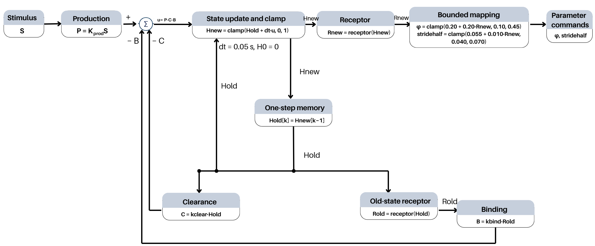

# ใบงาน Lab04 (รายงาน 1–2 หน้า)

ชื่อ/รหัส  1. นางสาว ธมนันท์ ลิ้มอิ่ม รหัสนักศึกษา 6652500248 
        2. นาย ธนวัฒน์ อ่อนดำ รหัสนักศึกษา 6652500256 
        3. นาย ศุภากร เผ่าพวง รหัสนักศึกษา 6752500444 
กลุ่ม 7 วันที่ 8/10/2569 
code version/hash cc1c2cb3de6d03e70213c07c8863e2c7852ebe510807465491f4a97bcea11f6b

## A. ก่อนรัน (10 นาที)

วาด block diagram แล้วเขียนประโยคเชื่อมแต่ละคู่ S, P/C/B, H, R, phi/stride ให้เห็นว่า state เก็บประวัติอย่างไร

S กระตุ้นการผลิต P ส่วน Clearance C และ Binding B ลด H จึงอัปเดต H จาก P−C−B แล้วนำ H ไปคำนวณ R เพื่อปรับ φ และ stride โดยเก็บ H จากรอบก่อนเป็น state ทำให้การตอบสนองขึ้นกับประวัติของสิ่งเร้า ไม่ใช่แค่ S ปัจจุบัน

S กำหนด P ส่วน H_old และ R_old กำหนด C และ B จากนั้นใช้ P−C−B อัปเดต H แล้วแปลงเป็น R เพื่อกำหนด phi/stride โดยเก็บ H ไว้ใช้ในรอบถัดไป

| Comparison | prediction ก่อนรัน | เหตุผลจาก term ในสมการ | ผลจริงหลังรัน |
|---|---|---|---|
| C2 vs C1 | คิดว่า H จะเพิ่มเร็วขึ้น | k_prod มากขึ้น เลยสร้าง H ได้มากขึ้น | เพิ่มเร็วขึ้นจริง: rise C2=1.0500000000000007 s, C1=2.6999999999999993 s |
| C3 vs C1 | คิดว่า H จะลดช้าลง | k_clear น้อยลง เลยกำจัด H ช้าลง | ลดช้าลงจริง: recovery C3=5.100000000000001 s, C1=2.8500000000000014 s |
| C4 vs C1 | คิดว่า H จะสะสมมากขึ้น | ไม่มี binding มาช่วยลด H | สะสมมากขึ้นจริง: AUC C4=10.754720280354444, C1=9.999644341657826 |
| C0 vs C1 | คิดว่า C0 จะตอบสนองเร็วกว่า | C0 ใช้ R=S โดยตรง ส่วน C1 ต้องรอ H สะสม | ตอบสนองเร็วกว่า: latency C0=0.05000000000000071 s, C1=0.15000000000000036 s |

เขียนว่า prediction ใดอาจเปลี่ยนเพราะ H มี upper bound=1 คิดว่า C2 และ C4 อาจไม่ได้มี H สูงกว่า C1 ครับ

## B. เติม code และคำนวณมือ (20 นาที)

1. แยก source equation กับ proposed course model คนละกรอบ
**สมการจากแหล่งอ้างอิง**
Hc(t) = beta Hc(t−1) + Hg(t) − Hr(t)
Hg(t) = alpha f(S(t))
Hr(t) = sum(gamma_i Receptor_i(t))

**Proposed course model สำหรับ Lab04**
R_old = clamp((H_old − H_min)/(H_max − H_min), 0, 1)
P = k_prod S
C = k_clear H_old
B = k_bind R_old
H_raw = H_old + dt(P − C − B)
H_new = clamp(H_raw, 0, 1)
R_new = receptor(H_new)

dt = 0.05 s และ H, R อยู่ในช่วง [0,1]
P, C และ B มีหน่วย normalized H/s

2. เติม receptor ก่อน แล้วทดสอบ H=.2, H_min=.1, H_max=.5
R=(0.2−0.1)/(0.5−0.1)=0.25
3. เติม step: เก็บ H_old และ R_old ก่อนคำนวณ removal
4. เมื่อ H_old=0,S=1 ให้คำนวณ P,C,B,H_raw,H_new,R_new,phi,stride แล้วทำรอบถัดไป
ใช้ค่า C1: S=1, dt=0.05, k_prod=0.8, k_clear=0.6, k_bind=0.2
รอบที่ 1: H_old=0, R_old=0
P=0.8×1=0.8
C=0.6×0=0
B=0.2×0=0
H_raw=0+0.05(0.8-0-0)=0.04
H_new=0.04, R_new=0.04
phi=0.20+0.20×0.04=0.208 rad
stride_half=0.055+0.010×0.04=0.0554 m

รอบที่ 2: H_old=0.04, R_old=0.04
P=0.8×1=0.8
C=0.6×0.04=0.024
B=0.2×0.04=0.008
H_raw=0.04+0.05(0.8-0.024-0.008)=0.0784
H_new=0.0784, R_new=0.0784
phi=0.20+0.20×0.0784=0.21568 rad
stride_half=0.055+0.010×0.0784=0.055784 m

5. รัน checker เก็บ output หากไม่ผ่านให้บันทึก case และเหตุที่แก้

| input_time_s | time_s | P | C | B | H_raw | H | R | phi |
|---:|---:|---:|---:|---:|---:|---:|---:|---:|
| 10.00 | 10.05 | 0.8 | 0 | 0 | 0.04 | 0.04 | 0.04 | 0.208 |
| 10.05 | 10.10 | 0.8 | 0.024 | 0.008 | 0.0784 | 0.0784 | 0.0784 | 0.21568 |

แถว CSV ที่เลือกสอดคล้องกับ time convention อย่างไร? input_time_s คือเวลาเริ่มช่วงรับ input ส่วน time_s คือเวลาหลังอัปเดตสถานะ จึงห่างกัน dt=0.05 s เช่น รับ input ที่ 10.00 s แล้วได้ H=0.04 ที่ 10.05 s จากนั้นรับ input ที่ 10.05 s แล้วได้ H=0.0784 ที่ 10.10 s

## C. Controlled comparison (20 นาที)

รัน C0–C4 ใช้ dt,duration,H0,stimulus,mapping เดียวกัน เปิด report.html และกรอกค่าจาก metrics.json ไม่อ่านค่าด้วยสายตาอย่างเดียว

| Condition | peak_H | AUC_H | latency s | rise s | recovery s | upper clamp fraction | phi TV rad |
|---|---|---|---|---|---|---|---|
| C0 | N/A | N/A | 0.05000000000000071 | 0.0 | 0.05000000000000071 | N/A | 0.4 |
| C1 | 0.9997153923247306 | 9.999644341657826 | 0.15000000000000036 | 2.6999999999999993 | 2.8500000000000014 | 0.0 | 0.39982925159514415 |
| C2 | 1.0 | 10.67240976713657 | 0.09999999999999964 | 1.0500000000000007 | 2.8500000000000014 | 0.29 | 0.39994307846494614 |
| C3 | 1.0 | 11.389144853304954 | 0.15000000000000036 | 1.4499999999999993 | 5.100000000000001 | 0.2733333333333333 | 0.3978895104347413 |
| C4 | 1.0 | 10.754720280354444 | 0.15000000000000036 | 1.6999999999999993 | 3.8000000000000007 | 0.25833333333333336 | 0.39954775179800084 |

ตอบด้วยตัวเลข: C3 ฟื้นช้ากว่า C1 เท่าไร? C2/C3 peak เท่ากันหรือไม่ และ metric ใดแยกสองระบบนี้ได้? C0 มี H หรือไม่? TV ที่ต่ำกว่าเพียงอย่างเดียวพิสูจน์คุณภาพ gait ได้หรือไม่?
C3 ฟื้นช้ากว่า C1 อยู่ 2.25 s (5.10−2.85)
C2 และ C3 มี peak H เท่ากันคือ 1.0 แต่ recovery ต่างกัน คือ 2.8500000000000014 กับ 5.100000000000001 s และ AUC ต่างกัน คือ 10.67240976713657 กับ 11.389144853304954
C0 ไม่มี H เพราะใช้ stimulus ไปเป็น R โดยตรง
TV ต่ำอย่างเดียวบอกว่า gait ดีไม่ได้ ต้องทดสอบการเดินและความเสถียรเพิ่ม

## D. Extreme tests และ handoff (10 นาที)

รัน zero,one,spike,fault ของ C1 ตรวจว่า spike มี on interval เพียงหนึ่งแถว fault มี flag และ state reset แล้วเริ่มกลับได้ แยก software bounds จาก actuator limits และ emergency stop
zero: H และ R เป็น 0 ตลอด
one: H และ R เพิ่มเข้าใกล้ 1
spike: S=1 เพียงช่วง 10.00–10.05 s
fault: ที่ 15.05 s มี fault=1 และ H=R=0 แล้วกลับมาทำงานที่ 15.10 s
software bounds จำกัดค่าคำสั่งในโค้ด ส่วน actuator limits เป็นข้อจำกัดของมอเตอร์จริง และ emergency stop ใช้หยุดระบบฉุกเฉิน

ทดลองส่ง contract เดิมของ Week03 ถ้ามี แล้วตรวจ phi/stride ที่ R=0 และ R=1 ระบุสิ่งที่ Lab04 ยังไม่ได้ทดสอบ ทดลองใช้ contract เดิม Week03 แล้ว รัน C1 ได้ผลตรงกับเดิมทั้ง 601 แถว ตรวจ mapping ได้: R=0 ได้ phi=0.20 rad, stride_half=0.055 m และ R=1 ได้ phi=0.40 rad, stride_half=0.065 m
Lab04 ยังไม่ได้ทดสอบ gait การชน แรงบิด พลังงาน และความปลอดภัยของหุ่นยนต์จริง

## E. สรุปส่งงาน (10 นาที)

เขียน 3 ย่อหน้า: (1) กลไกและ provenance (2) prediction ที่ข้อมูลสนับสนุน/ปฏิเสธพร้อมตัวเลข (3) ข้อจำกัดและการทดลอง Week05 ที่ต้องทำต่อ แนบคำสั่งรันและ config/hash ทุกข้อสรุปต้องอ้าง metric หรือ timestamp

ระบบใช้ S สร้าง H แล้วหัก clearance และ binding จากสถานะเดิม ก่อนอัปเดต H และแปลงเป็น R เพื่อกำหนด phi/stride ใช้ proposed course model ในข้อ B และ student controller โดย dt=0.05 s ตาม config.json ตัวอย่าง input ที่ 10.00 s ได้ H=0.04000000000000001 ที่ 10.05 s ใน C1_step.csv ส่วน controller SHA256 คือ cc1c2cb3de6d03e70213c07c8863e2c7852ebe510807465491f4a97bcea11f6b

ผลใน metrics.json สนับสนุน prediction ทั้งสี่ข้อ: C2 เพิ่มเร็วกว่า C1 โดย rise เป็น 1.0500000000000007 กับ 2.6999999999999993 s; C3 ลดช้ากว่า C1 โดย recovery เป็น 5.100000000000001 กับ 2.8500000000000014 s; C4 สะสมมากกว่า C1 โดย AUC เป็น 10.754720280354444 กับ 9.999644341657826 และ C0 ตอบสนองเร็วกว่า C1 โดย latency เป็น 0.05000000000000071 กับ 0.15000000000000036 s แต่ prediction ว่า C2/C4 อาจไม่สูงกว่า C1 ไม่ตรงกับผล เพราะ peak เป็น 1.0 เทียบกับ C1 ที่ 0.9997153923247306

Extreme tests พบ spike เปิดเพียงช่วง 10.00–10.05 s และ fault ทำให้ H=R=0 ที่ 15.05 s ก่อนกลับมาคำนวณที่ 15.10 s ตาม CSV แต่ยังไม่ได้ทดสอบ gait และหุ่นยนต์จริง แม้ C3 มี phi TV=0.3978895104347413 rad ต่ำกว่า C1 ที่ 0.39982925159514415 rad ก็ยังยืนยันคุณภาพการเดินไม่ได้ ใน Week05 ควรทดสอบการเดิน ความเสถียร การชน แรงบิด พลังงาน actuator limits และ emergency stop

คำสั่งรันซ้ำ: `../06_Additional/RUN_COMMANDS.md`
config/hash: `../03_Results/comparison/config.json` และ config ของแต่ละ extreme test

Checklist: ☑ code ☑ comparison CSV 5 files ☑ extreme CSV 4 files ☑ config ☑ plots ☑ metrics ☑ report ☑ คำสั่งรันซ้ำ
