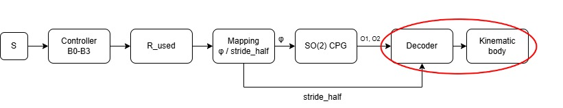

# ใบงาน Lab 05 — Prediction, timing, evidence

ฉบับพิมพ์: [Word](Lab05_Student_Worksheet_TH.docx)

ชื่อ/1. นางสาว ธมนันท์ ลิ้มอิ่ม รหัสนักศึกษา 6652500248 2. นาย ธนวัฒน์ อ่อนดำ รหัสนักศึกษา 6652500256 3. นาย ศุภากร เผ่าพวง รหัสนักศึกษา 6752500444 กลุ่ม 7 วันที่ 16/10/2569

**ขอบเขต:** main runner เป็น proposed course model ใช้ scheduled stimulus และ kinematic body; contact demo ใช้ synthetic signals ไม่ใช่ ALCS terrain experiment ของ paper

## 1. ก่อนรัน: hypothesis และ architecture (10 นาที)

1. วาด S→controller→R_used→φ/stride→CPG→decoder→body ของ Lab แล้ววงจุดที่ยังไม่มี independent sensory feedback

2. เขียน hypothesis1 ข้อสำหรับ B1 เทียบ B2 พร้อมตัวชี้วัดและทิศทางที่คาด เช่น TV, latency/recovery, segmentfrequency หลีกเลี่ยงคำว่า “ดีขึ้น” โดยไม่มี metric
คาดว่า B2 จะมี maxΔφ/step (rad) น้อยกว่า B1 แต่มี command latency (s) มากกว่า เพราะต้องสะสมฮอร์โมนก่อน
3. B3 ตัดอะไรออกจาก B2? สิ่งใดที่ยังคงมี memory?
B3 ตัดเทอม binding โดยตั้ง k_bind = 0 แต่ H ยังสะสมต่อจากค่าเดิม จึงยังมี memory ของฮอร์โมน
4. ตาราง provenance: source equation1 รายการ, proposedcourseequation1 รายการ, expectedmeasurement1 รายการ และ metric ที่วัดไม่ได้ 1 รายการ

| ประเภท | รายการ |
|---|---|
| Source equation | release = CI / (1 + exp(−SIF)) ตาม Eq. (1) ของบทความ โดย contact demo ใช้ CI = 1 |
| Proposed course equation | อัปเดต H ด้วยวิธี Euler จาก production − clearance − binding แล้วจำกัดค่าให้อยู่ในช่วง [0,1] |
| Expected measurement | ความถี่ CPG ช่วง on [10,20) s หน่วย Hz วัดจาก rising crossings ของ o₁ |
| Metric ที่ยังวัดไม่ได้ | เสถียรภาพการทรงตัวของหุ่นยนต์จริง เพราะยังไม่มีข้อมูล CoM, support polygon และ body dynamics ที่เพียงพอ |

## 2. รัน comparison และตรวจเวลา (15 นาที)

รัน comparison ตาม README เปิด report เลือก B2 เลื่อน timeline ไป 10.00/10.05s แล้วเปิด B2_states.csv/B2_intervals.csv เพื่อยืนยัน

| command/input time (s) | state end time (s) | H_start | H_end | R_used | φ ที่ใช้ (rad) | stride_half ที่ใช้ (m) |
|---|---|---|---|---|---|---|
| 10.00 | 10.05 | 0.000000 | 0.040000 | 0.000000 | 0.200000 | 0.055000 |
| 10.05 | 10.10 | 0.040000 | 0.078400 | 0.040000 | 0.208000 | 0.055400 |
| 20.00 | 20.05 | 0.999715 | 0.959727 | 0.999715 | 0.399943 | 0.064997 |

อธิบายจาก CSV ว่าเหตุใด B1 command latency กับ state latency จึงต่างกัน: B1 ใช้ R_used = S ทันที ณ command_time = 10.00 s
จึงมี command latency = 0.00 s
ส่วน states.csv บันทึกค่า R หลัง update ที่ state_time = 10.05 s
จึงมี state latency = 0.05 s ซึ่งต่างกันหนึ่ง timestep (dt = 0.05 s)
ความต่างนี้เกิดจากลำดับการคำนวณและเวลาบันทึกข้อมูลของแบบจำลอง
ไม่ใช่ความหน่วงของฮาร์ดแวร์

ตรวจ warmup/initialstates ใน config: ทุก condition เริ่ม CPG เหมือนกันหรือไม่? หลักฐาน ทุก condition เริ่ม CPG เหมือนกัน ตาม initial_states ใน config.json:
B0–B3 มี o1 = −0.026965330782974153 และ
o2 = −0.5608626776309884 เท่ากันทั้งหมด
หลัง warmup ร่วมกัน 10 s ด้วย alpha = 1.1 และ phi = 0.2 rad
จึงไม่ได้เริ่มเปรียบเทียบจากสถานะ CPG ที่ต่างกัน

## 3. เปรียบเทียบผลและข้อจำกัด (15 นาที)

เติมจาก metrics และ segment_metrics พร้อมหน่วย ห้ามคัดลอกผล source paper มาใส่เป็นผล run นี้

| condition | TV φ (rad) | maxΔφ/step (rad) | TV stride (m) | cmd latency (s) | cmd recovery (s) | on frequency (Hz) | on distance (m) |
|---|---|---|---|---|---|---|---|
| B0 | 0.000000 | 0.000000 | 0.000000 | N/A | N/A | 0.624877 | 0.778743 |
| B1 | 0.400000 | 0.200000 | 0.020000 | 0.00 | 0.00 | 1.268366 | 1.825152 |
| B2 | 0.399827 | 0.008000 | 0.019991 | 0.15 | 2.85 | 1.202760 | 1.706250 |
| B3 | 0.399534 | 0.008000 | 0.019977 | 0.15 | 3.80 | 1.225791 | 1.727498 |

1. ผลข้อใดสนับสนุน hypothesis และผลข้อใดไม่สนับสนุน? สนับสนุน เพราะ B2 มี maxΔφ/step เท่ากับ 0.008 rad น้อยกว่า B1 ที่ 0.200 rad แต่มี command latency 0.15 s มากกว่า B1 ที่ 0.00 s ผลทั้งสองค่าตรงตามที่คาดไว้ ส่วน TV φ ใกล้กัน จึงสรุปไม่ได้ว่าฮอร์โมนทำให้ TV ลดลงมาก
2. การลด TV ยืนยันว่าหุ่นยนต์ไม่ล้มหรือใช้พลังงานน้อยลงหรือไม่? ขาดข้อมูลอะไร? ยืนยันไม่ได้ เพราะ TV วัดการเปลี่ยนคำสั่ง ยังขาดข้อมูลการทรงตัว เช่น CoM, support polygon และแรงสัมผัส รวมถึงข้อมูลกำลังไฟฟ้าหรือแรงบิดกับความเร็วข้อต่อสำหรับคำนวณพลังงาน
3. Bounds เหมือนกันทำให้ commandamplitude เท่ากันหรือไม่? ใช้ peak/trace ประกอบ ไม่จำเป็น เพราะ bounds เป็นแค่ขอบเขตที่อนุญาต ผลนี้ B1 มี peak φ = 0.400000 rad ส่วน B2 ≈ 0.399943 rad โดย trace ของ B1 เปลี่ยนทันที แต่ B2 ค่อย ๆ เปลี่ยน แม้ใช้ bounds เดียวกัน
4. ทำไมไม่ใช้ frequency เฉลี่ย 30s แทน pre/on/off? เพราะค่ารวมจะทำให้ไม่เห็นความต่างของแต่ละช่วง เช่น B2 มีความถี่ pre = 0.624878 Hz, on = 1.202760 Hz และ off = 0.698234 Hz การแยกช่วงจึงเห็นว่าหลังปิดสิ่งเร้า ความถี่ยังไม่กลับเท่าช่วงก่อนกระตุ้น

## 4. เปลี่ยนหนึ่งปัจจัยและตรวจ fault (20 นาที)

เลือก phi-only หรือ stride-only ตั้ง prediction ก่อนรัน ตรวจ parameter ที่คงที่จาก intervalCSV แล้วเปรียบเทียบ B1/B2 กับ bothmapping

สิ่งที่เปลี่ยน: mapping จาก both เป็น phi-only ให้ปรับเฉพาะ φ สิ่งที่คงที่: stride_half = 0.055 m รวมถึง stimulus และค่าพารามิเตอร์อื่น metric หลัก: ระยะทางช่วง on (m) prediction: คาดว่า B1 และ B2 จะมีระยะทางช่วง on น้อยกว่าแบบ both เพราะ stride_half ไม่เพิ่มตามสิ่งเร้า

ผลและข้อจำกัด causalclaim: ผลตรงตามที่คาด เมื่อใช้ phi-only ระยะทางช่วง on ของ B1 ลดจาก 1.825152 เป็น 1.549111 m และ B2 ลดจาก 1.706250 เป็น 1.467193 m โดย stride_half คงที่ 0.055 m ทุกแถว และความถี่ CPG เท่าเดิมเมื่อเทียบกับ both จึงเห็นผลของการตรึง stride ในแบบจำลองนี้ แต่ยังสรุปถึงหุ่นยนต์จริงไม่ได้

รัน faultprofile เปิด input15.00 แล้วบันทึก:

| field | B2 value |
|---|---|
| fault at command15.00 | 1 |
| H_used / R_used | 0 / 0 |
| φ / stride ที่ใช้ | 0.200 rad / 0.055 m |
| H state15.05 | 0.000 |
| H state15.10 | 0.040 |

อธิบายว่า fallback ทำก่อนหรือหลัง command และเหตุใด policy นี้ยังไม่รับรอง hardware safety: Fallback ทำก่อนสร้าง command โดยรีเซ็ต H/R เป็น 0 ทำให้ใช้ φ = 0.2 rad และ stride_half = 0.055 m ทันที แต่ยังรับรอง hardware safety ไม่ได้ เพราะไม่ได้จำลองแรงสัมผัส การทรงตัว และข้อจำกัดของมอเตอร์จริง

## 5. Contact mini-lab (20 นาที)

เปิด contactreport เลือก cases ด้านล่าง เปรียบเทียบ SI, SIF, absoluteerror และ validity

| case | SI ของแต่ละขาโดยทั่วไป | SIF | absolute error | สิ่งที่อนุมานไม่ได้ |
|---|---|---|---|---|
| matched | ทุกขา = 1 | 0 | 0 | ยังยืนยันการเดินของหุ่นยนต์จริงไม่ได้ |
| gain-offset | ทุกขา = 1 | ≈ 0 | 0.162844 | correlation สูงไม่ได้แปลว่าขนาดสัญญาณตรงกัน |
| mixed-delay | LF/RM/LH = 1; RF/LM/RH ≈ 0 | ≈ 0.499995 | 0.226007 | ยังสรุปว่าหุ่นยนต์เสียการทรงตัวไม่ได้ |
| all-inverted | ทุกขา = −1 | ≈ 0 | 0.631375 | SIF ต่ำไม่ได้แปลว่าสัญญาณตรงกัน |
| constant | ทุกขา N/A | N/A | 0 | error เป็น 0 ไม่ได้ทำให้คำนวณ correlation ได้ |

1. ทำไม gain-offset ให้ correlation สูงแม้ error ไม่เป็น 0? 
เพราะ Pearson correlation ไม่เปลี่ยนเมื่อคูณสัญญาณด้วยค่าบวกและบวกค่าคงที่ จึงได้ SI = 1 แม้ขนาดและ offset ต่างจากสัญญาณเดิม
2. เมื่อทุกขา inverted ทำไม SIF จึงยังเป็น 0? release ที่ SIF0 มีค่าเท่าไร? 
เพราะ SI ทุกขาเท่ากับ −1 เหมือนกัน จึงไม่มีความต่างระหว่างขาและได้ SIF = 0 ส่วน release = 0.5 เมื่อ CI = 1
3. constant ควรเป็น SI0 หรือ N/A? 
ควรเป็น N/A เพราะสัญญาณคงที่มีความแปรปรวนเป็นศูนย์ ทำให้คำนวณ Pearson correlation ไม่ได้
4. fault หนึ่ง sample มีผลต่อ rollingwindows กี่ rows ไม่นับ startup49rows? ตรวจ CSV
กระทบ 50 rows ตั้งแต่ sample 300–349 หรือเวลา 15.00–17.45 s เพราะแต่ละ rolling window ใช้ข้อมูล 50 samples โดยไม่นับ startup 49 rows
5. pairedPearson ของ demo มีสถานะ source/proposed ใด? ต่อ Cg/MI แล้วหรือยัง? 
เป็น proposed course definition ไม่ใช่การทำซ้ำ Eq. (3) ตามที่พิมพ์ในบทความ และยังไม่ได้ต่อเข้า Cg/MI หรือส่ง feedback กลับไปยัง main runner
## 6. ส่งงานและ exit ticket (10 นาที)

ส่ง prediction ก่อนรัน, config/manifest/rawCSV ของ comparison+one-factorrun+fault, contactmetrics และ CSV หนึ่ง case ที่อภิปราย, ตารางพร้อมหน่วยและกราฟ 2 รูป พร้อมรายงาน 2–3 หน้า บอกคำสั่งและ Pythonversion เพื่อรันซ้ำ

Exit: เขียนหนึ่ง claim ที่ข้อมูลรองรับ และหนึ่ง claim ที่ยังรองรับไม่ได้ พร้อมชื่อ metric/ข้อมูลที่ต้องเพิ่ม
ข้อมูลรองรับ: B2 เปลี่ยนคำสั่งต่อ step น้อยกว่า B1 แต่ตอบสนองช้ากว่า โดย maxΔφ/step เท่ากับ 0.008 เทียบกับ 0.200 rad และ command latency เท่ากับ 0.15 เทียบกับ 0.00 s

ข้อมูลยังไม่รองรับ: B2 ใช้พลังงานน้อยกว่า B1 ต้องเพิ่มการวัดกำลังไฟฟ้าตามเวลาและคำนวณพลังงานรวม (J) เพื่อเปรียบเทียบ
**Rubric20 คะแนน:** architecture/provenance4; timing/fault4; reproducibility/data3; quantitativecomparison/one-factor5; interpretation/contact/N/A4 คะแนนมาจากเหตุผลกับหลักฐาน ไม่ได้ให้เต็มเพราะ runner รันผ่านหรือเพราะผล “ดีขึ้น” ตามคาด

**Workshop 25 นาทีในคาบ Week05:** ทำข้อ 1 แบบย่อ 5 นาที, ข้อ 2 10 นาที, ข้อ 3 10 นาที ส่วน one-factor/fault/contact เป็น extended lab หรือการบ้าน ใช้เวลารวม 90 นาทีตามใบงาน ไม่รวมเวลาติดตั้ง Python
